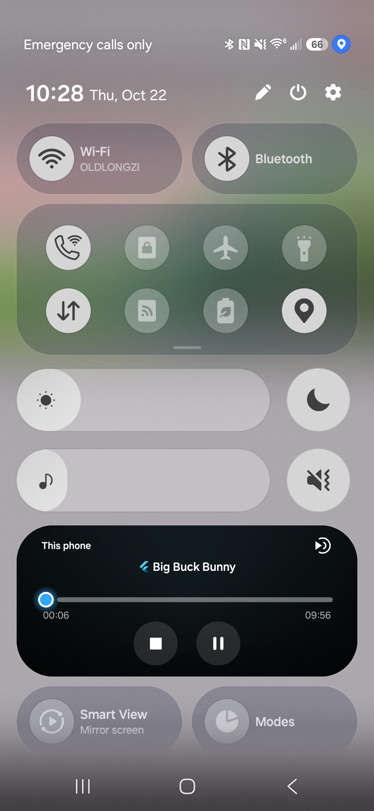
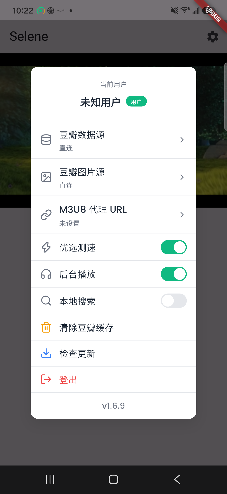

# Android playback and build setup

Android playback continues when the display turns off or the app goes into the
background. The notification and lock screen expose play, pause, stop, and (for
on-demand content) seeking. The service uses the existing media_kit player, so
returning to the app keeps the same media, position, and playback speed.

The Android user settings menu includes **后台播放** (background playback),
enabled by default and saved across app restarts. Turn it off to pause when the
app is hidden or the screen is locked. Background media controls cannot resume
playback while it is disabled, and returning to the app does not auto-resume.
Visible picture-in-picture playback remains available.

Pausing releases the foreground service and CPU wake lock; stopping or closing
the player also clears active playback. Unplugging headphones, losing audio
focus, or dismissing the app from Recents pauses playback. Playback does not
automatically resume after an interruption.

## Toolchain

- Flutter 3.47 or newer, Dart 3.13 or newer.
- Gradle 9.8.2 (wrapper download verified by SHA-256).
- Android Gradle Plugin 9.4.1 and Kotlin 2.4.21.
- Java 17 or newer compatible with Gradle; Java/Kotlin bytecode targets Java 17.
- Android NDK 30.0.16248370, the stable r30 release.
- Android SDK versions follow the Flutter SDK defaults.

Flutter currently requires the `android.builtInKotlin=false` and
`android.newDsl=false` compatibility properties. The application uses the typed
Android extension and Kotlin compiler options APIs.

`pubspec.lock` records the upgraded dependency set. `package_info_plus` and `xml`
remain at the newest versions resolvable with the other dependencies; do not use
dependency overrides to force an incompatible major release.

## Checks

```sh
flutter pub get
flutter test
flutter build apk --debug --target-platform android-arm64
```

On Windows, building the desktop plugins additionally requires Developer Mode
for symbolic links. For an Android-only PowerShell session, set
`$env:FLUTTER_WINDOWS = 'false'` before `flutter pub get` to skip desktop plugin
setup. This does not change Flutter's saved configuration.

For repeatable device playback without a server login, build the smoke entry:

```sh
flutter build apk --debug --target-platform android-arm64 \
  -t test/device/background_audio_smoke.dart
```

The smoke entry uses the production video widget and audio handler with a public
sample video. It logs playback position every five seconds. Use
`--dart-define=SMOKE_LIVE=true` to exercise the live-player configuration, and
`--dart-define=SMOKE_MEDIA_URL=<url>` to select a test stream.

Verify that positions advance while the screen is off, notification controls
pause/resume the same player, and closing the player clears its media session.
Also verify real live streams, headphone disconnection, incoming calls, and
returning to video after unlocking on the target devices.

Installing a debug APK over a release signed by a different key is rejected by
Android. Preserve the existing installation and data by using a separate test
application ID when that happens.

To build a separate installation, append
`--android-project-arg=seleneApplicationIdSuffix=.backgroundtest` to either APK
build command. Both builds display the name **Selene**. The ordinary build keeps
the original application ID.

## Verification (2026-10-22)

- Built the full Android ARM64 debug app with the toolchain above.
- Fourteen automated playback, settings persistence, cleanup, race, and audio
  focus tests passed.
- Focused analysis of the changed playback code and test harness passed.
- On the connected Android 17 phone, a local MP4 advanced from 3.083 seconds to
  25.500 seconds while the phone was dozing with no display suspend blocker.
- Media controls paused playback with the screen off, released foreground state,
  and resumed the same player in the foreground service.
- Closing the widget and pressing Stop cleared active media playback and removed
  foreground service state.
- With background playback disabled, screen-off playback paused and a remote
  Play command left it paused; returning to the app did not resume playback.
- With background playback enabled, playback advanced from 148.166 to 158.291
  seconds while the phone was dozing.

Device screenshots use the smoke entry with the production player and user menu,
a fresh test profile, and Big Buck Bunny rather than account-specific media:

| Notification controls | Background playback toggle |
| --- | --- |
|  |  |

The sample ran through the production video widget and audio handler. Actual
network live streams and incoming-call handling were not tested on the device.
